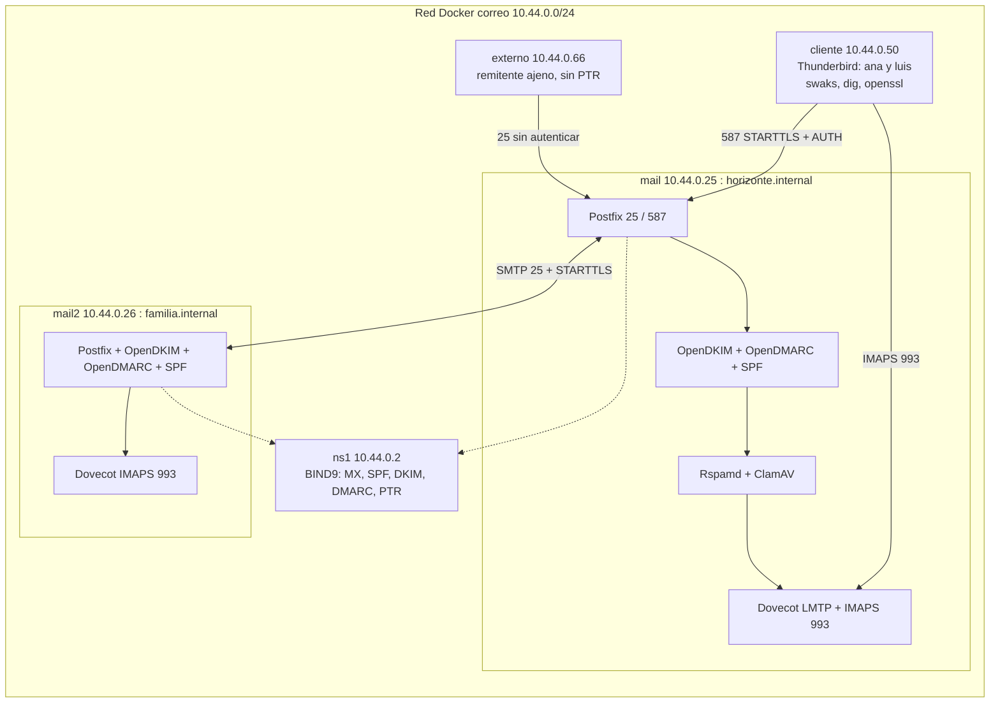

# Actividad 4 — Correo institucional seguro: Postfix, Dovecot con TLS, SPF, DKIM, DMARC y filtrado antispam

Proyecto del grupo Ubuntu de la materia Tecnología Web I (UPDS). Integra los laboratorios 12 y 13 sobre el dominio de laboratorio de la U.E. Horizonte (`horizonte.internal`), levantado con Docker: servidor SMTP (Postfix), IMAP sobre TLS (Dovecot), zona DNS con MX, SPF, DKIM (OpenDKIM) y DMARC verificada con `dig`, envío y recepción entre buzones con Thunderbird para dos usuarios, análisis de cabeceras, relé abierto descartado con pruebas y filtrado antispam y antivirus (Rspamd y ClamAV).

## Arquitectura



Los cinco nodos usan la misma imagen (`Dockerfile`: Ubuntu 24.04 con systemd y todo el software de correo); cada uno instala solo su rol con los scripts de `scripts/`. El repositorio se monta en `/lab` (solo lectura) y la carpeta `compartido/` (CA, claves y registros DKIM) en `/compartido`.

## Requisitos

- **Docker Engine** (Linux o WSL) o **Docker Desktop**, con **Docker Compose v2**.
- Permiso para contenedores `privileged` y **cgroup v2** (los nodos ejecutan systemd; `cgroup: host`).
- Subred `10.44.0.0/24` libre en Docker, unos 6 GB de RAM libres y conexión a internet en el primer arranque (paquetes y base de firmas de ClamAV, unos 110 MB).
- Git y Bash (en Windows: Git Bash o WSL).

## Inicio rápido

```bash
git clone https://github.com/TW1-GrupoUbuntu/Actividad_4.git
cd Actividad_4
bash scripts/levantar.sh                                  # construye, instala DNS, CA y correo y publica DKIM
docker exec -w /lab act4-cliente bash scripts/verificar.sh
```

Resultado esperado:

```text
Resultado: 26 de 26 comprobaciones correctas
```

Para borrar todo: `bash scripts/limpiar.sh`.

Notas:

- Las contraseñas de los buzones se generan al azar en `compartido/clave_buzones` (permisos 600) y no se suben al repositorio; las claves privadas de la CA, de los certificados y de DKIM tampoco (`.gitignore`). Ningún script imprime la contraseña.
- Los archivos están en formato LF (`.gitattributes`). En Windows, si Git convierte los finales de línea, ejecutar `git config core.autocrlf input` antes de clonar.
- `scripts/levantar.sh` se ejecuta desde la carpeta del repositorio y, en Windows, conviene clonarlo en el sistema de archivos de Linux (WSL), no en `/mnt/c`.

## Estructura

| Ruta | Contenido |
|---|---|
| `Dockerfile`, `docker-compose.yml` | Imagen base y los cinco nodos (`ns1`, `mail`, `mail2`, `cliente`, `externo`) |
| `dns/` | `named.conf.*` y las zonas `horizonte.internal`, `familia.internal` y la inversa (MX, SPF, DMARC, SRV, PTR) |
| `postfix/` | `main.cf.in` (plantilla del servidor SMTP: relé cerrado, TLS, SASL, milters) y `master.cf.add` (servicio de *submission* en el 587 y consulta SPF) |
| `dovecot/` | `99-act4.conf` (IMAPS 993, TLS obligatorio, LMTP, SASL, carpeta Junk) y `antispam.sieve` |
| `opendkim/` | `opendkim.conf.in` y `opendmarc.conf.in` (plantillas) |
| `rspamd/` | Configuración local de Rspamd (milter, umbrales 6 y 15, ClamAV, cabeceras) |
| `scripts/levantar.sh`, `limpiar.sh` | Levantan todo el entorno desde cero y lo eliminan |
| `scripts/instalar_dns.sh`, `crear_ca.sh`, `instalar_correo.sh`, `publicar_dkim.sh`, `subir_serial.sh` | Instalación de cada rol, CA propia, publicación de la clave DKIM en el DNS y subida del *serial* |
| `scripts/verificar.sh` | Verificador: DNS, TLS, relé cerrado, envío y recepción, DKIM/SPF/DMARC, antispam y antivirus (26 pruebas) |
| `scripts/leer_buzon.py`, `analizar_cabeceras.py`, `resumen_rspamd.py`, `cambiar_selector.sh` | Lectura de buzones por IMAPS, análisis de cabeceras, resumen de la decisión de Rspamd y cambio del selector DKIM (para pruebas) |
| `scripts/instalar_thunderbird.sh`, `perfil_thunderbird.sh`, `thunderbird_flujo.sh` | Thunderbird dos usuarios en pantalla virtual (perfiles y flujo de pruebas con `xdotool`) |

## Usuarios y dominios

| Dominio | Servidor | Buzones |
|---|---|---|
| `horizonte.internal` | `mail.horizonte.internal` (10.44.0.25) | `ana`, `luis`, `marta` |
| `familia.internal` | `mail.familia.internal` (10.44.0.26) | `rosa`, `pedro` |

Para leer un buzón desde el cliente:

```bash
docker exec -w /lab act4-cliente python3 scripts/leer_buzon.py mail.horizonte.internal luis INBOX listar
```

## Pruebas rápidas

```bash
# DNS: MX, SPF, DKIM y DMARC
docker exec act4-cliente dig +short @10.44.0.2 horizonte.internal MX
docker exec act4-cliente dig +short @10.44.0.2 horizonte.internal TXT
docker exec act4-cliente dig +short @10.44.0.2 _dmarc.horizonte.internal TXT
docker exec act4-cliente dig +short @10.44.0.2 mail._domainkey.horizonte.internal TXT

# Relé abierto descartado (debe responder 554 5.7.1 Relay access denied)
docker exec act4-externo swaks --server mail.horizonte.internal --from falso@horizonte.internal --to victima@otro.example --quit-after RCPT

# Spam: cadena de prueba GTUBE (554) y virus de prueba EICAR (554 virus found)
docker exec act4-cliente swaks --server mail.horizonte.internal --from rosa@familia.internal --to luis@horizonte.internal --body 'XJS*C4JDBQADN1.NSBN3*2IDNEN*GTUBE-STANDARD-ANTI-UBE-TEST-EMAIL*C.34X'
```

## Thunderbird con dos usuarios

`scripts/instalar_thunderbird.sh` descarga el binario oficial de Mozilla (el paquete de Ubuntu es un *snap*, que no funciona en contenedores) y `scripts/perfil_thunderbird.sh <usuario> "<nombre>"` crea un perfil con IMAP en el 993 (SSL/TLS), SMTP de envío en el 587 (STARTTLS) y la CA del laboratorio como autoridad de confianza. `scripts/thunderbird_flujo.sh` automatiza una sesión completa de `ana` y `luis` (inicio de sesión, envío, lectura, respuesta y código fuente del mensaje) sobre una pantalla virtual y guarda capturas en `compartido/`.

## Seguridad

- Relé cerrado (`mynetworks = 127.0.0.0/8`, `reject_unauth_destination`); solo usuarios autenticados envían a dominios externos.
- Puerto 587 con TLS y autenticación obligatorios y remitente igual al usuario autenticado; IMAP solo por TLS (el 143 está cerrado); TLS 1.2 o superior.
- SPF `-all`, DKIM (RSA 2048, selector `mail`) y DMARC `p=quarantine` con alineación estricta; Rspamd marca el spam desde 6 puntos y rechaza desde 15; ClamAV bloquea virus.
- La CA, los certificados y la clave DKIM de este laboratorio son de demostración y se generan localmente; no reutilizar en producción.
